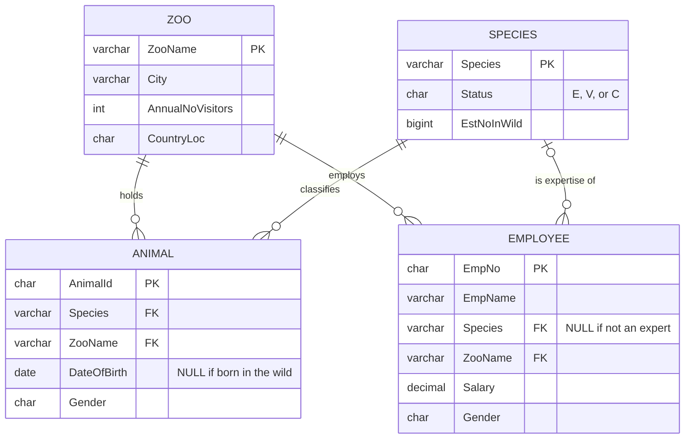
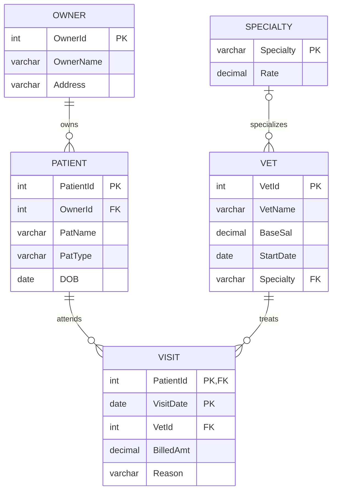

# SQL Fundamentals: Zoo Database

A relational database for managing zoos, animals, species, and staff, with 30+ queries covering filtering, pattern matching, aggregation, grouping, multi-table joins, and data modification. Originally built during my Data and Information Management coursework, then rebuilt with a full schema script, my own sample data, and corrected, tested queries.

Written for **Microsoft SQL Server (T-SQL)**. The queries use standard SQL and run on most relational databases with little or no change.

## Data Model

## Files

| File | Purpose |
|------|---------|
| `schema.sql` | Creates the four tables with primary and foreign keys |
| `sample_data.sql` | Fictional sample data, designed so every query returns a meaningful result |
| `queries.sql` | All queries, grouped by skill, each with a plain-English description |
| `diagrams/` | ER diagram for a second data model (see below) |

## How to Run

1. Create an empty database in SQL Server (SSMS or Azure Data Studio).
2. Run `schema.sql`, then `sample_data.sql`.
3. Run any query in `queries.sql`.

## What the Queries Cover

- **Filtering and sorting:** `WHERE`, `AND`/`OR`, operator precedence, multi-column `ORDER BY`
- **Pattern matching and dates:** `LIKE` with `%` and `_` wildcards, date ranges
- **Aggregation:** `COUNT`, `COUNT(DISTINCT)`, `SUM`, `AVG`, `MIN`, and correct handling of `NULL`
- **Grouping:** `GROUP BY` with `HAVING`
- **Joins:** two- and three-table `INNER JOIN`s, composite join conditions, `DISTINCT` to remove duplicates
- **Data modification:** `INSERT`, `UPDATE` with a calculated expression, `DELETE`

### Lessons Learned

Revisiting this project, I found and fixed several bugs in my original answers. Two of them are worth calling out:

- **NULL is not a value.** `WHERE Species != 'NULL'` compares against the *text* "NULL". It happened to return the right count, but only by accident, and the same pattern on a date column (`DateOfBirth != 'null'`) throws a conversion error. The correct test is `IS NULL` or `IS NOT NULL`.
- **Join on every shared key.** Matching lion experts to lions by species alone also matched experts at zoos with no lions. The join needed to match on zoo *and* species (query 5.3).

## Second Data Model: Veterinary Clinic

A separate model I designed in **erwin Data Modeler**, covering owners, their pets, vets and their specialties, and clinic visits. Each visit is identified by the patient and the visit date.

The original erwin diagram is in [`diagrams/vet-clinic-erd-erwin.png`](diagrams/vet-clinic-erd-erwin.png).

## Author

William Wellington
